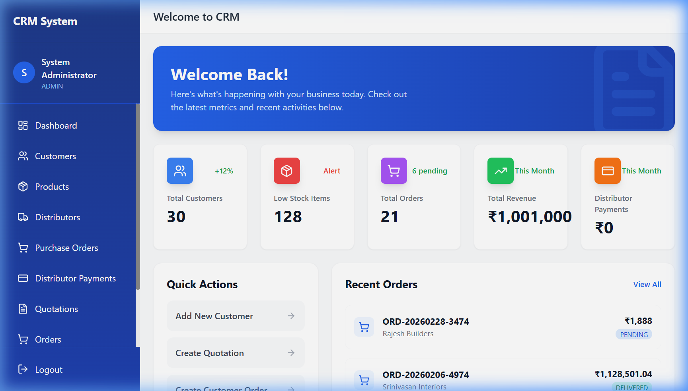
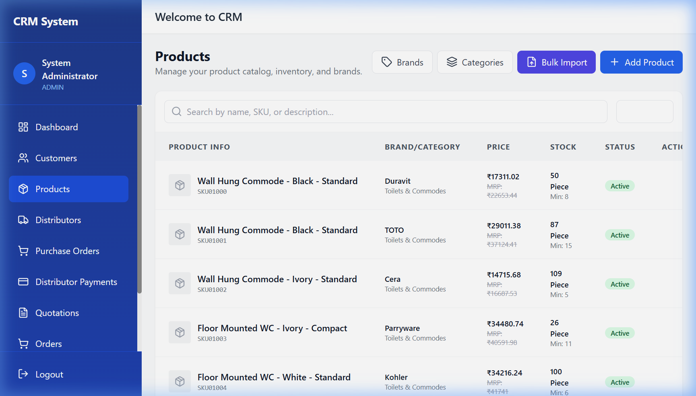
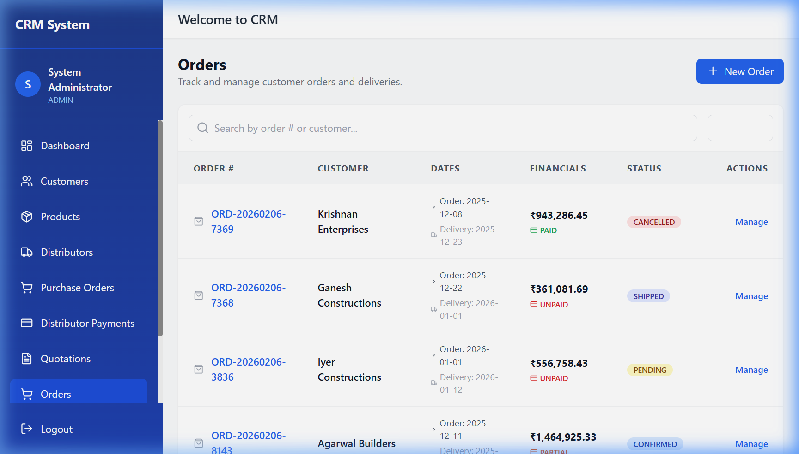
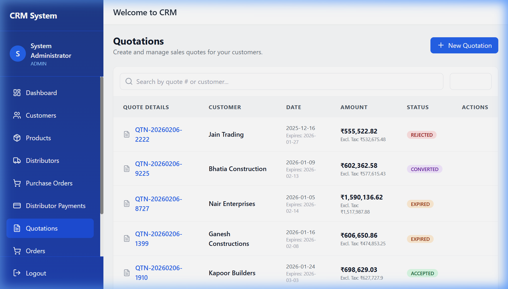

# Sanitaryware CRM System

> **Verification status (14 October 2026, 07:36 UTC):** The application services respond locally, but production readiness is not established. MySQL/Testcontainers is blocked by Docker availability; Android native verification is withheld for missing QA environment variables and low memory; frontend/mobile audits report 11 (6 high) and 32 (21 high) advisories. See [TESTING.md](TESTING.md) and the [current project review](docs/gstack-project-review-2026-10-11.md) for timestamped evidence. No secrets are documented here.

Enterprise-level Customer Relationship Management system built specifically for sanitaryware retail businesses.

## Project Preview

| Dashboard | Products |
|-----------|----------|
|  |  |

| Orders | Quotations |
|--------|------------|
|  |  |

## Technology Stack

### Backend
- **Framework**: Java Spring Boot 3.2.2
- **Database**: MySQL 8.0+
- **Authentication**: JWT (JSON Web Tokens)
- **ORM**: Spring Data JPA with Hibernate
- **Build Tool**: Maven

### Frontend
- **Framework**: React 18 with Vite
- **Language**: JavaScript
- **Styling**: TailwindCSS
- **State Management**: Zustand
- **HTTP Client**: Axios
- **UI Components**: TailwindCSS components and Lucide icons

### Mobile
- **Framework**: React Native with Expo
- **Navigation**: React Navigation
- **Authentication Storage**: AsyncStorage-backed JWT session
- **API Client**: Axios against the same Spring Boot REST API

## Features

- ✅ **User Management**: Role-based access control (Admin, Manager, Sales, Warehouse)
- ✅ **Customer Management**: Complete customer profiles with purchase history
- ✅ **Product Catalog**: Brand tracking, hierarchical categories, inventory management
- ✅ **Quotation System**: Create, send, and convert quotations to orders
- ✅ **Order Management**: Full order lifecycle tracking from creation to delivery
- ✅ **Payment Tracking**: Multiple payment methods with balance calculation
- ✅ **Inventory Management**: Stock tracking with low stock alerts
- 🚧 **Reports & Analytics**: Sales, customer, and inventory analytics
- 🚧 **Notifications**: WhatsApp and Email integration

## Prerequisites

- Java 17 or higher
- Maven 3.6+
- MySQL 8.0+
- Node.js 20.19+ and npm
- Git

## Setup Instructions

### Database Setup

1. Install MySQL and create the database:
```sql
CREATE DATABASE sanitaryware_crm CHARACTER SET utf8mb4 COLLATE utf8mb4_unicode_ci;
```

2. Set `DATABASE_URL`, `DATABASE_USERNAME`, and `DATABASE_PASSWORD` in your environment. Use `backend/.env.example` as a reference; do not put real credentials in source files.

### Backend Setup

1. Navigate to the backend directory:
```bash
cd backend
```

2. Build the project:
```bash
mvn clean install
```

3. Run the application against your configured MySQL database:
```bash
mvn spring-boot:run
```

The backend will start on `http://localhost:8081`

For local QA without MySQL credentials, run the in-memory H2 profile:
```bash
mvn spring-boot:run -Dspring-boot.run.profiles=qa
```

The QA profile uses a disposable in-memory H2 database and creates development test users. Use it for local and automated tests. The `dev` profile also uses H2; neither profile is for production.

### Frontend Setup

1. Navigate to the frontend directory:
```bash
cd frontend
```

2. Install dependencies:
```bash
npm install
```

3. Start the development server:
```bash
npm run dev
```

The frontend will start on `http://localhost:5173`

### Mobile Android Setup

The mobile app lives in `mobile/` and reuses the existing Spring Boot API.
It is scaffolded on Expo SDK 55, which targets React Native 0.83 and requires Node.js 20.19.x or newer.

1. Navigate to the mobile directory:
```bash
cd mobile
```

2. Install dependencies:
```bash
npm install
```

3. Copy the mobile environment file and set the API URL:
```bash
copy .env.example .env
```

For Android Emulator, use:
```env
EXPO_PUBLIC_API_BASE_URL=http://10.0.2.2:8081/api
```

For a real Android phone on the same Wi-Fi, replace the host with your computer LAN IP:
```env
EXPO_PUBLIC_API_BASE_URL=http://192.168.1.10:8081/api
```

For production, use your deployed HTTPS backend URL.

## Verification

**Current gate status (14 October 2026, 07:26 UTC):** a fresh independent rerun passed backend 282/282, frontend unit 12/12 and build, and mobile unit 5/5 and lint. The latest Playwright 156/156 and bug-hunt 22/22 are from 06:36 UTC and were not rerun in this pass. Frontend/mobile audits still report 11 (6 high) and 32 (21 high) advisories. MySQL/Testcontainers is blocked by unavailable Docker; native Android builds and root verification were withheld for missing QA environment variables and insufficient memory headroom. Manual role coverage is partial and formal CSO is not assessed. The project is not production-ready; see the current timestamped entry in `reports/verification-summary.json`.

See [TESTING.md](TESTING.md) for setup, required environment variables, browser installation and cleanup. Root `npm run verify` includes legacy frontend workflows, real Expo pagination/lifecycle smoke, Android export/debug/release, real MySQL migrations and npm audits as well as the existing suites. Start QA backend, frontend and Expo web first. The latest expanded root verification is incomplete; inspect `reports/verification-summary.json` and [the 14 October continuation results](reports/verification-continuation-2026-10-14.json). An older 14-step green report does not cover this expanded inventory. Current repairs and limits are recorded in [CRM_DEVELOPMENT_PROGRESS_AND_VERIFICATION.md](CRM_DEVELOPMENT_PROGRESS_AND_VERIFICATION.md). The iPhone project is preserved; do not disable Application Control if Win32 error 4551 recurs.

The last complete cross-project test follow-up (14 October 2026, 06:36 UTC) passed backend 282/282, frontend 12/12 plus build, mobile 5/5 plus lint, Playwright 156/156 (Chromium, Pixel 5, iPhone 13/WebKit), and bug-hunt 22/22. A later 07:26 UTC independent rerun refreshed backend/frontend/mobile unit, build, and lint checks only; it did not rerun Playwright or bug-hunt. Neither run clears release gates: root verification remains historically incomplete (19 passed/1 failed/0 skipped), MySQL/Testcontainers needs a real Docker-enabled CI run, Android native builds were not rerun, and high dependency advisories remain (frontend 6, mobile 21). The prior gate diagnostics are in the 06:52 UTC JSON entry; the newer 07:26 UTC entry records this rerun. Do not treat prior 275-backend, 33-mobile-advisory, or credential-blocked snapshots as the newest evidence.

The latest authenticated manual route and responsive QA evidence is documented in [docs/manual-complete-functional-qa-2026-10-12.md](docs/manual-complete-functional-qa-2026-10-12.md). A focused 14 October ADMIN browser follow-up opened all six report tabs, exercised audit-log actor filtering/reset, and inspected an existing order and its payment form without recording a receipt. It did not verify all roles, console/network logs, or the full user workflow. Current diagnostic evidence and the incomplete root status are in [reports/verification-summary.json](reports/verification-summary.json).

Catalogue PDF imports return a batch ID. For disposable QA data, supply only the batch IDs you intend to clean through `QA_CATALOGUE_IMPORT_BATCH_IDS` before `npm run cleanup`; the ADMIN-only cleanup route is scoped to one batch and is unavailable outside `dev`/`qa`. Product row counts reflect saved rows, while `imageLinkFailures` reports image problems separately. Dashboard recent-order payloads use a role-safe projection: SALES/WAREHOUSE do not receive order totals or company-wide financial aggregates.

4. Start Expo:
```bash
npm start
```

5. Run Android:
```bash
npm run android
```

## Initial Administrator Setup

After first run, create an administrator via the `/api/auth/register` endpoint. Choose a strong password locally and never commit it:

```json
{
  "username": "admin",
  "email": "admin@example.com",
  "password": "<choose-a-strong-password>",
  "fullName": "System Administrator",
  "phoneNumber": "1234567890",
  "role": "ADMIN"
}
```

## API Documentation

### Authentication Endpoints

- `POST /api/auth/register` - Register new user
- `POST /api/auth/login` - User login
- `GET /api/auth/me` - Get current user

### Customer Endpoints

- `GET /api/customers` - List all customers
- `POST /api/customers` - Create customer
- `GET /api/customers/{id}` - Get customer details
- `PUT /api/customers/{id}` - Update customer
- `DELETE /api/customers/{id}` - Delete customer

### Product Endpoints

- `GET /api/products` - List all products
- `POST /api/products` - Create product
- `GET /api/products/{id}` - Get product details
- `PUT /api/products/{id}` - Update product
- `DELETE /api/products/{id}` - Delete product

### Order Endpoints

- `GET /api/orders` - List all orders
- `POST /api/orders` - Create order
- `GET /api/orders/{id}` - Get order details
- `PUT /api/orders/{id}` - Update order

### Quotation Endpoints

- `GET /api/quotations` - List all quotations
- `POST /api/quotations` - Create quotation
- `GET /api/quotations/{id}` - Get quotation
- `PUT /api/quotations/{id}` - Update quotation
- `POST /api/orders/from-quotation/{id}` - Convert a quotation to an order

## Project Structure

```
SanitarywareCRM/
├── backend/
│   ├── src/main/java/com/sanitaryware/crm/
│   │   ├── config/          # Configuration classes
│   │   ├── controller/      # REST controllers
│   │   ├── dto/             # Data Transfer Objects
│   │   ├── entity/          # JPA entities
│   │   ├── repository/      # Data repositories
│   │   ├── security/        # Security & JWT
│   │   └── service/         # Business logic
│   └── pom.xml
├── frontend/
│   ├── src/
│   │   ├── components/      # React components
│   │   ├── pages/           # Page components
│   │   ├── services/        # API services
│   │   ├── store/           # State management
│   │   └── utils/           # Utility functions
│   └── package.json
└── README.md
```

## Configuration

### Email Configuration (Gmail)
Set environment variables; never put credentials in tracked application properties:
```text
MAIL_USERNAME=<mail-account>
MAIL_PASSWORD=<local-or-deployment-secret>
```

### WhatsApp Configuration (Twilio)
Set environment variables; never put credentials in tracked application properties:
```text
TWILIO_ACCOUNT_SID=<account-id>
TWILIO_AUTH_TOKEN=<local-or-deployment-secret>
TWILIO_WHATSAPP_NUMBER=<configured-whatsapp-sender>
```

### JWT Secret
**Important**: Production requires `JWT_SECRET` to be provided as an environment variable. It must be at least 32 characters.

## Production Readiness

- Copy `backend/.env.example` and `frontend/.env.example` into your deployment environment and set real values there. Do not commit production secrets.
- The default backend profile uses `spring.jpa.hibernate.ddl-auto=validate`; manage schema changes with migrations or controlled SQL scripts.
- Public self-registration is disabled after the first bootstrap user. The first registered user becomes `ADMIN`; later registrations require an authenticated `ADMIN` or `MANAGER` and create `SALES` users.
- Set `CORS_ALLOWED_ORIGIN_PATTERNS` to the exact production frontend origin.
- Build checks:
```bash
cd backend && mvn test
cd frontend && npm run build
```

## License

Proprietary - All Rights Reserved

## Support

For support and questions, please contact your system administrator.
