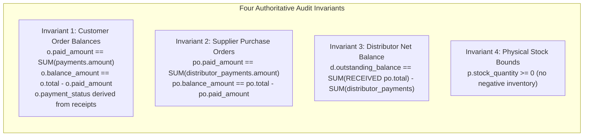

# Historical Database Audit & Data Reconciliation Runbook

**Project**: Sanitaryware CRM  
**Target Release**: Production Ready (V1.0)  
**Phase**: Phase 7 (Historical Database Audit & Non-Destructive Data Repair)  
**Authority**: Financial Invariants & Invariant Contracts (`docs/PHASE1-FINANCIAL-CONTRACT.md`)  

---

## 1. Executive Policy & Audit Principles

When cutting over to production or migrating from legacy retail/wholesale spreadsheets and databases, preexisting records may contain historical data drift caused by uncoordinated writes, manual database edits, or legacy bugs.

### Core Audit Principles
1. **Audits are Strictly Read-Only**: The reconciliation audit scripts (`backend/scripts/phase1-reconciliation-report.sql`) inspect and report discrepancies; they **never silently mutate financial or inventory tables**.
2. **Authoritative Ledger Supremacy**: Receipts (`payments` and `distributor_payments`) are the authoritative legal source of truth. Order headers (`paid_amount`, `balance_amount`, `payment_status`) must derive from the ledger, not vice versa.
3. **No Fabricated Records**: Never invent artificial payment entries or fake invoices to force balances to agree.
4. **Audited Non-Destructive Corrections**: Any data correction must be executed within an explicit database transaction with pre-conditions, rollback safety, and complete audit logging.

---

## 2. Financial & Inventory Invariants Inspected



### Invariant 1: Customer Order Balance vs Payments Ledger
- **Condition**: For every order `o`, `o.paid_amount` must equal `COALESCE(SUM(p.amount), 0)`.
- **Condition**: `o.balance_amount` must equal `o.total - o.paid_amount`.
- **Condition**: `o.payment_status` must derive authoritatively:
  - `receipts == 0` $\rightarrow$ `UNPAID`
  - `0 < receipts < total` $\rightarrow$ `PARTIAL`
  - `receipts >= total` $\rightarrow$ `PAID`

### Invariant 2: Purchase Order vs Supplier Payments Ledger
- **Condition**: For every purchase order `po`, `po.paid_amount` must equal `COALESCE(SUM(dp.amount), 0)`.
- **Condition**: `po.balance_amount` must equal `po.total - po.paid_amount`.
- **Condition**: Overpayments (`receipts > total`) must be flagged as supplier over-crediting.

### Invariant 3: Distributor Outstanding Balance
- **Condition**: A distributor's `outstanding_balance` must equal the sum of all `RECEIVED` purchase orders minus the sum of all recorded distributor payments.

### Invariant 4: Non-Negative Physical Inventory
- **Condition**: `products.stock_quantity >= 0`. Negative values indicate past overselling or failure to record receipt batches.

---

## 3. Automated Audit Execution Runbook

### Method A: Automated PowerShell Runner (Windows)
```powershell
# Run against active Docker staging/production container:
.\scripts\run-database-audit.ps1 -Mode docker -Database sanitaryware_crm_staging

# Run against remote MySQL host:
.\scripts\run-database-audit.ps1 -Mode cli -DbHost "prod-db.internal" -DbPort 3306 -Database "sanitaryware_crm_prod" -User "crm_user"
```

### Method B: Automated Bash Runner (Linux / Cloud VM)
```bash
chmod +x ./scripts/run-database-audit.sh

# Run against local Docker container:
./scripts/run-database-audit.sh docker sanitarywarecrm-mysql-1 crm_user <password> sanitaryware_crm_staging

# Run against remote host:
./scripts/run-database-audit.sh cli localhost crm_user <password> sanitaryware_crm_prod
```

### Method C: Direct SQL Query via Docker
```bash
docker exec -i sanitarywarecrm-mysql-1 mysql -u crm_user -p<password> sanitaryware_crm_staging < backend/scripts/phase1-reconciliation-report.sql
```

### Audit Output Artifact
Reports are automatically written to `audit-artifacts/reconciliation-report-<timestamp>.md` with timestamp, duration, raw tabular results, and discrepancy analysis.

---

## 4. Authorized Non-Destructive Remediation Procedures

If the audit discovers discrepancies in preexisting databases, follow these authorized repair protocols:

### Procedure A: Repairing Order Header Balance Drift
**Scenario**: The order header displays an outdated `paid_amount` or incorrect `payment_status`, but the `payments` receipt rows are legitimate.

```sql
-- Step 1: Execute within a single explicit transaction
START TRANSACTION;

-- Step 2: Lock affected order row for update
SELECT id, order_number, total, paid_amount, balance_amount, payment_status 
FROM orders 
WHERE id = 101 
FOR UPDATE;

-- Step 3: Compute exact ledger receipts
SET @ledger_paid = (SELECT COALESCE(SUM(amount), 0) FROM payments WHERE order_id = 101);

-- Step 4: Update order header to reflect authoritative ledger facts
UPDATE orders 
SET paid_amount = @ledger_paid,
    balance_amount = total - @ledger_paid,
    payment_status = CASE 
        WHEN @ledger_paid = 0 THEN 'UNPAID'
        WHEN @ledger_paid >= total THEN 'PAID'
        ELSE 'PARTIAL'
    END,
    updated_at = NOW()
WHERE id = 101;

-- Step 5: Verify new values match invariants before committing
SELECT id, total, paid_amount, balance_amount, payment_status FROM orders WHERE id = 101;

COMMIT;
```

### Procedure B: Reconciling Erroneous or Duplicate Receipts
**Scenario**: A duplicate customer payment was recorded twice due to network replay before idempotency keys were active.

1. **Do NOT delete the payment row**: Deleting financial records destroys audit continuity.
2. **Execute an Authorized Reversal**:
   - Insert an authorized reversal record with negative or offsetting amount linked to the payment ID.
   - Record an audit log entry in `audit_logs` citing operator ID, reason, and approval authorization.
   - Trigger the application domain reversal action: `POST /api/orders/{id}/payments/{paymentId}/reverse`.

### Procedure C: Reconciling Distributor Balance Drift
**Scenario**: Advance payments were made to a distributor, but `d.outstanding_balance` was not decremented.

```sql
START TRANSACTION;

SELECT id, name, outstanding_balance FROM distributors WHERE id = 5 FOR UPDATE;

SET @expected = (
    SELECT (COALESCE(r.received_total, 0) - COALESCE(p.paid_total, 0))
    FROM distributors d
    LEFT JOIN (SELECT distributor_id, SUM(total) received_total FROM purchase_orders WHERE status='RECEIVED' AND distributor_id = 5) r ON 1=1
    LEFT JOIN (SELECT COALESCE(p.distributor_id, o.distributor_id) distributor_id, SUM(p.amount) paid_total FROM distributor_payments p LEFT JOIN purchase_orders o ON o.id=p.purchase_order_id WHERE COALESCE(p.distributor_id, o.distributor_id) = 5) p ON 1=1
    WHERE d.id = 5
);

UPDATE distributors 
SET outstanding_balance = @expected, updated_at = NOW() 
WHERE id = 5;

COMMIT;
```

### Procedure D: Correcting Negative Stock Quantities
**Scenario**: Legacy software permitted stock to fall below zero (`stock_quantity < 0`).

1. **Physical Cycle Count Required**: Software cannot guess real physical warehouse stock. A warehouse team member must physically inspect the bin/shelf.
2. **Authorized Stock Adjustment Entry**:
   - Record the physical count via the authorized inventory adjustment endpoint (`PUT /api/products/{id}`).
   - An automatic audit event is written to `audit_logs` logging the variance (`[UPDATE] PRODUCT {id} stock adjusted from X to Y by {username}`).

---

## 5. Pre-Remediation & Post-Remediation Sign-Off Protocol

| Step | Action | Command / Artifact | Required Sign-Off |
|---|---|---|---|
| **1. Baseline Audit** | Execute read-only reconciliation | `.\scripts\run-database-audit.ps1` | Lead Developer / QA |
| **2. Full DB Backup** | Capture full snapshot | `mysqldump -u crm_user -p crm_db > pre_repair_backup.sql` | Database Administrator |
| **3. Draft Remediation** | Prepare SQL patch with old-value guards | `scripts/repair-patch-<ticket>.sql` | Finance Lead / Engineering Lead |
| **4. Apply Remediation** | Execute patch inside transaction | `mysql < scripts/repair-patch-<ticket>.sql` | Database Administrator |
| **5. Post-Audit Rerun** | Verify 0 discrepancies | `.\scripts\run-database-audit.ps1` | QA Lead (Must report 0 rows) |
