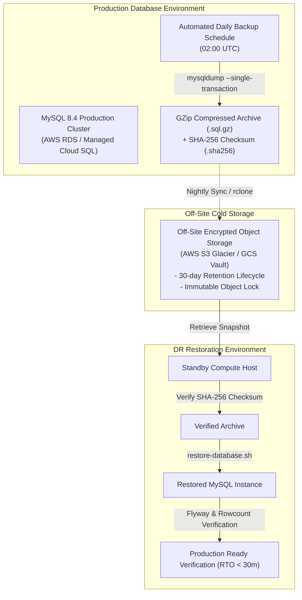

# Disaster Recovery & Operational Observability Runbook

**Project**: Sanitaryware CRM  
**Target Release**: Production Ready (V1.0)  
**Phase**: Phase 10 (Operational Observability, Automated Backups & Disaster Recovery)  
**Target Objectives**: **RTO < 30 minutes** (Recovery Time) | **RPO < 1 hour** (Recovery Point)  

---

## 1. Disaster Recovery Objectives & Topology



---

## 2. Automated Backup Execution

### 2.1 Backup Automation Command
Backups are executed using the hardened cross-platform scripts:

- **Linux / Docker Production Host**:
  ```bash
  ./scripts/backup-database.sh docker sanitarywarecrm-mysql-1 crm_user <password> sanitaryware_crm_prod
  ```
- **Windows Host / Orchestration**:
  ```powershell
  .\scripts\backup-database.ps1 -Mode docker -Database sanitaryware_crm_prod
  ```

### 2.2 Backup Invariants Enforced
1. **Point-in-Time Consistency**: Uses `--single-transaction` so InnoDB tables are snapshotted without blocking read/write traffic.
2. **Streaming Compression**: Immediately compresses raw SQL with GZip, reducing disk footprint by $> 75\%$.
3. **Cryptographic Verification**: Generates companion `.sha256` checksum file to detect bitrot or tampering.
4. **Automated Pruning**: Enforces a 30-day retention window, purging archives older than 30 days automatically.

### 2.3 Automated Cron Schedule (Linux Production)
Configure the system crontab on the database host or management VM:

```cron
# Run daily database snapshot at 02:00 UTC and sync to offsite storage:
0 2 * * * /opt/sanitaryware-crm/scripts/backup-database.sh docker sanitarywarecrm-mysql-1 crm_user "$DATABASE_PASSWORD" sanitaryware_crm_prod >> /var/log/crm-backups.log 2>&1
```

---

## 3. Disaster Recovery Restoration Protocol

### Step 1: Locate & Verify Snapshot
1. Select the latest backup archive from `backups/` or off-site S3 storage:
   ```bash
   ls -lt backups/
   ```
2. Verify that the companion `.sha256` checksum file exists alongside the `.sql.gz` archive.

### Step 2: Execute Automated Restore
Execute the restoration script against the standby or target MySQL instance:

- **Linux**:
  ```bash
  ./scripts/restore-database.sh backups/sanitaryware_crm_prod_backup_YYYYMMDD-HHMMSS.sql.gz docker sanitarywarecrm-mysql-1 crm_user <password> sanitaryware_crm_prod
  ```
- **Windows**:
  ```powershell
  .\scripts\restore-database.ps1 -BackupArchive "backups\sanitaryware_crm_prod_backup_YYYYMMDD-HHMMSS.sql.gz" -Mode docker -Database sanitaryware_crm_prod
  ```

The restore script automatically:
1. Calculates the SHA-256 hash of the archive and compares it with `.sha256`. If the hash does not match, execution halts immediately with an error.
2. Decompresses the GZip stream directly into MySQL without writing large uncompressed SQL files to disk.
3. Queries `flyway_schema_history` to verify that all 11 schema migrations are present and valid.

### Step 3: Application Health & Schema Verification
1. Restart the backend container against the restored database:
   ```bash
   docker compose -f docker-compose.prod.yml restart backend
   ```
2. Verify backend startup logs:
   - Confirm `Hibernate: ddl-auto=validate` passes with 0 schema mismatches.
   - Confirm Tomcat started and opened port `8081`.
3. Probe health endpoint:
   ```bash
   curl -i http://localhost/api/health
   # Expected: {"status":"UP","components":{"db":{"status":"UP"}}}
   ```

---

## 4. Operational Observability & Logging Standards

### 4.1 Health Check Endpoints

| Endpoint | Protocol | Component Monitored | Expected Output |
|---|---|---|---|
| `http://localhost/healthz` | HTTP GET | Frontend Nginx & static assets | `200 OK (ok)` |
| `http://localhost/api/health` | HTTP GET | Spring Boot & MySQL Connectivity | `200 OK ({"status":"UP"})` |

### 4.2 Error Handling & Zero-PII Leakage Policy
- In `application-prod.properties`, stack trace and exception name leakage are disabled:
  ```properties
  server.error.include-message=never
  server.error.include-binding-errors=never
  server.error.include-stacktrace=never
  server.error.include-exception=false
  ```
- The backend's `GlobalExceptionHandler` converts all uncaught runtime exceptions into standardized `ApiErrorResponse` envelopes (`status`, `error`, `message`) while logging internal stack traces exclusively to internal server logs.
- Sensitive authentication headers (`Authorization: Bearer ...`) and passwords are never logged to console or files.
