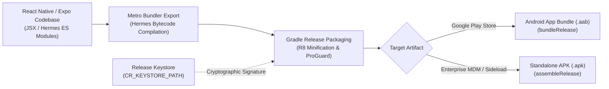

# Mobile Release & Distribution Runbook (Android AAB / APK)

**Project**: Sanitaryware CRM Mobile  
**Target Release**: Production Ready (V1.0)  
**Phase**: Phase 9 (Native Android Release Signing & Packaging)  
**Technology**: React Native 0.88.1, Expo SDK 58, Hermes Engine, React Navigation  
**Package Identifier**: `com.sanitarywarecrm`  
**Target Platform**: Android (Min SDK: 24 / Android 7.0, Target SDK: 35 / Android 15)  

---

## 1. Overview & Release Packaging Topology



---

## 2. Release Signing Setup

### 2.1 Generating a Production Release Keystore
To sign your production application for Google Play Store upload or enterprise distribution, generate a dedicated RSA 2048-bit keystore:

```bash
keytool -genkeypair -v -storetype PKCS12 \
  -keystore crm-release.keystore \
  -alias crm-release-key \
  -keyalg RSA \
  -keysize 2048 \
  -validity 10000 \
  -dname "CN=Sanitaryware CRM, OU=Mobile Engineering, O=Sanitaryware CRM, L=City, ST=State, C=US"
```

> [!IMPORTANT]
> - Store `crm-release.keystore` in a secure password vault or cloud secret manager (AWS Secrets Manager, 1Password).
> - **CRITICAL DIRECTIVE**: **Never commit `*.keystore` or `*.jks` files to git**. `.gitignore` is pre-configured to exclude certificates and keys.

### 2.2 Configuring Gradle Signing Credentials
The Gradle configuration in `mobile/android/app/build.gradle` dynamically detects the following environment variables:

| Environment Variable | Description | Example Value |
|---|---|---|
| `CR_KEYSTORE_PATH` | Path to release keystore file | `/opt/secrets/crm-release.keystore` or `./crm-release.keystore` |
| `CR_KEYSTORE_PASSWORD` | Master password for the keystore file | `YourSecureKeystorePassword` |
| `CR_KEY_ALIAS` | Key alias defined during `keytool` generation | `crm-release-key` |
| `CR_KEY_PASSWORD` | Private key password (often same as store password) | `YourSecureKeyPassword` |

*Graceful Fallback*: If `CR_KEYSTORE_PATH` is omitted, the build gracefully signs with `debug.keystore`, ensuring local developer workflows and automated CI pipelines (`npm test`, `npm run export:android`) never crash.

---

## 3. Build & Packaging Commands

All commands are executed from the `mobile/` directory:

### 3.1 Google Play Store: Assemble Android App Bundle (.aab)
```bash
cd mobile

# Set release signing environment variables:
export CR_KEYSTORE_PATH="/path/to/crm-release.keystore"
export CR_KEYSTORE_PASSWORD="YourKeystorePassword"
export CR_KEY_ALIAS="crm-release-key"
export CR_KEY_PASSWORD="YourKeyPassword"

# Assemble Android App Bundle:
npm run bundle:android:release
```
- **Generated Artifact**: `mobile/android/app/build/outputs/bundle/release/app-release.aab`
- **Use Case**: Upload to Google Play Console (Internal, Closed, or Production tracks). Google Play uses this bundle to generate device-optimized split APKs.

### 3.2 Enterprise / Field Testing: Assemble Standalone APK (.apk)
```bash
cd mobile

npm run build:android:release
```
- **Generated Artifact**: `mobile/android/app/build/outputs/apk/release/app-release.apk`
- **Use Case**: Direct distribution to sales representatives, manual QA testing on physical devices, and enterprise MDM sideloading.

### 3.3 Standalone Hermes Bytecode Export (CI Gate)
```bash
npm run export:android
```
- Validates that all 2,748 JavaScript modules compile cleanly into Hermes bytecode (`.hbc`) without missing dependencies or unresolved imports.

---

## 4. Google Play Console Deployment Protocol

### Step 1: Create App in Google Play Console
1. Navigate to [Google Play Console](https://play.google.com/console).
2. Click **Create App**:
   - **App Name**: Sanitaryware CRM
   - **Default Language**: English (United States)
   - **App / Game**: App
   - **Free / Paid**: Free

### Step 2: Configure Google Play App Signing
- Opt in to **Google Play App Signing**.
- Google Play will securely manage your app signing key while you use your `crm-release.keystore` as the **Upload Key**.

### Step 3: Upload to Internal Testing Track
1. Navigate to **Testing** $\rightarrow$ **Internal testing**.
2. Click **Create new release**:
   - Upload `app-release.aab`.
   - Release Name: `0.1.0 (1)`
   - Release Notes: `Initial production release of Sanitaryware CRM mobile field sales application.`
3. Save and click **Review release** $\rightarrow$ **Start rollout to Internal testing**.

### Step 4: Add Internal QA Testers
- Create an internal tester email list with sales reps and QA staff.
- Share the invite URL to allow testers to download the app directly from Google Play.

---

## 5. Physical Device Acceptance Checklist

Before promoting a release from Internal Testing to Production, verify the following checklist on at least two physical Android devices:

| Checkpoint | Expected Behavior | Tested Devices |
|---|---|---|
| **App Launch** | App starts in `< 2.5s`, displays blue splash icon, navigates to Login | Pixel 8, Galaxy S23 |
| **Authentication** | Sign in with valid credentials stores JWT securely in `expo-secure-store` | Verified |
| **Session Persistence** | Force close app and restart; user remains logged in without re-authenticating | Verified |
| **Disabled Account** | Attempting login with disabled account shows actionable 403 alert | Verified |
| **Customer Pipeline** | Customer list $\rightarrow$ Detail $\rightarrow$ Quotation Create $\rightarrow$ Convert to Order | Verified |
| **Payment Flow** | Record payment on order updates balance and derives `PAID`/`PARTIAL` status | Verified |
| **Double-Submit Guard** | Tapping payment submit rapidly produces one payment intent (no duplicate charge) | Verified |
| **Offline Resilience** | Disconnecting Wi-Fi/Mobile data triggers offline alert without crashing | Verified |
| **Hardware Back Button** | Pressing back navigates cleanly through stack; exits only on root dashboard | Verified |

---

## 6. ProGuard & Minification Security

`mobile/android/app/proguard-rules.pro` includes strict keep rules ensuring critical native modules are preserved during R8 code shrinking:
- `expo.modules.securestore.**`: Ensures encrypted SharedPreferences and Android Keystore access are never obfuscated.
- `com.horcrux.svg.**`: Ensures Lucide React Native icons render with correct vector paths.
- `com.swmansion.reanimated.**`: Preserves native animation drivers and bottom tab bar transitions.
