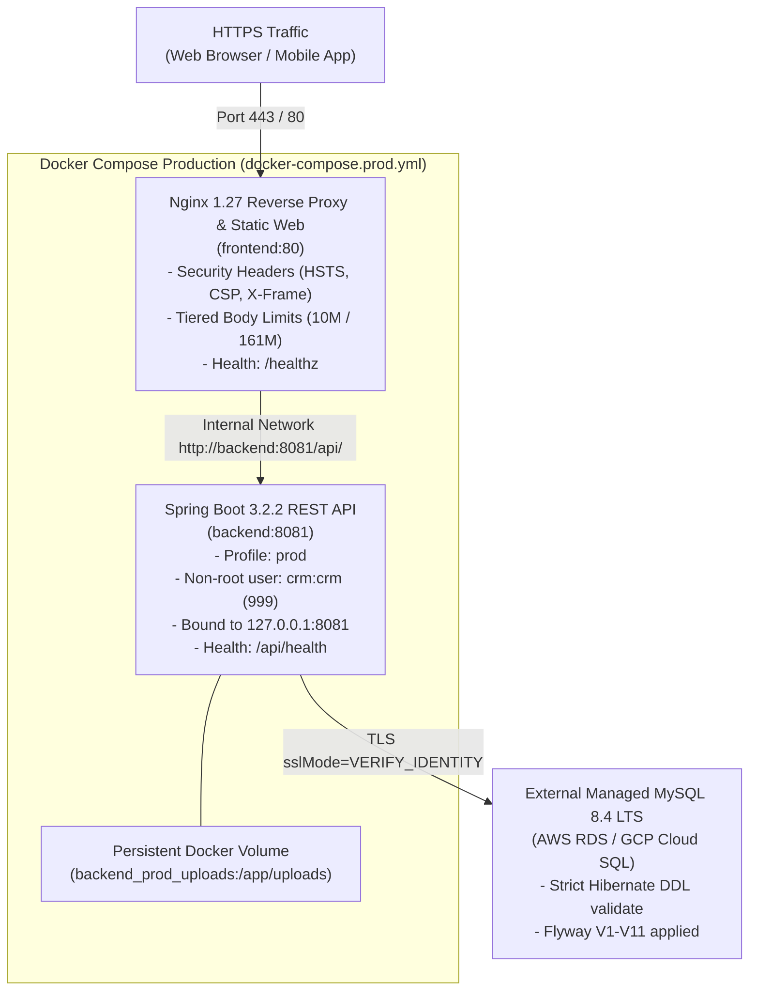

# Production Deployment Runbook & Hardening Specification

**Project**: Sanitaryware CRM  
**Target Release**: Production Ready (V1.0)  
**Phases Covered**: Phase 6 (Production Secrets Hardening) & Phase 8 (Production Cloud Deployment Preparation)  
**Architecture**: Containerized Spring Boot 3.2.2 Backend + Nginx 1.27 React 18 Web Frontend + External Managed MySQL 8.4 LTS  

---

## 1. Architecture & Deployment Topology



---

## 2. Phase 6: Production Secrets Hardening & Startup Validation

### 2.1 Runtime Configuration Validator (`ProductionConfigurationValidator`)
To prevent accidental exposure or deployment with default developer credentials, the backend includes an automated `@Profile("prod")` validator that aborts application startup if insecure defaults or placeholders are detected.

| Configuration Key | Minimum Invariant | Rejection Patterns |
|---|---|---|
| `JWT_SECRET` | >= 32 characters (256 bits) | Contains `replace_with`, `placeholder`, `changeme`, `change-me`, `local-only-change-me`, `secret_key_here`, or trivial repeated strings. |
| `DATABASE_PASSWORD` | >= 8 characters | Equals `password`, `root`, `admin`, `123456`, `1607`, `crm_password`, or contains `replace_with` / `placeholder`. |
| `CORS_ALLOWED_ORIGIN_PATTERNS` | Explicit HTTPS origin list | Wildcard `*`, contains `localhost`, `127.0.0.1`, `yourdomain.com`, `example.com`, or insecure `http://` protocols. |
| `DATABASE_URL` | Valid JDBC connection string | Contains `your-production-db-host`, `localhost`, or unconfigured template domains. |

*Verified by Unit Tests*: `com.sanitaryware.crm.config.ProductionConfigurationValidatorTest` (5/5 passed).

### 2.2 Environment Template (`.env.production.example`)
A comprehensive, non-sensitive template is provided at `.env.production.example` covering:
- **Database**: URL, user, password, and SSL mode (`VERIFY_IDENTITY`).
- **Security**: Cryptographic JWT secret, token expiration ms, and CORS allowed origins.
- **Upload Storage**: Persistent directory path (`/app/uploads`), max file size (`160MB`), max request size (`161MB`).
- **Rate Limiting**: Login rate limit attempts (5 per 15-minute window).
- **External Integrations**: Twilio WhatsApp credentials, SendGrid/SMTP email credentials.
- **Client Endpoints**: Relative API base for Web (`/api`), FQDN for Mobile.

### 2.3 Secret Leakage Prevention
- `.gitignore` strictly excludes `.env`, `.env.production`, `.env.staging`, `*.pem`, `*.p12`, `*.key`.
- Only sanitized `.example` files are committed to version control.
- In production, set file permissions:
  ```bash
  chmod 600 .env.production
  ```

---

## 3. Phase 8: Nginx Ingress & Reverse-Proxy Hardening

### 3.1 Defense-in-Depth Security Headers
`frontend/nginx.conf` enforces strict HTTP response headers on all routes:

```nginx
add_header Strict-Transport-Security "max-age=31536000; includeSubDomains; preload" always;
add_header X-Frame-Options "DENY" always;
add_header X-Content-Type-Options "nosniff" always;
add_header Referrer-Policy "strict-origin-when-cross-origin" always;
add_header Permissions-Policy "camera=(), microphone=(), geolocation=()" always;
add_header Content-Security-Policy "default-src 'self'; script-src 'self'; style-src 'self' 'unsafe-inline'; img-src 'self' data: blob:; font-src 'self' data:; connect-src 'self'; object-src 'none'; frame-ancestors 'none'; base-uri 'self'; form-action 'self';" always;
```

### 3.2 Tiered Request Body Limits (DoS Protection)
To protect against buffer exhaustion and Slowloris denial-of-service attacks, request body sizes are enforced hierarchically:

1. **Default Site Limit (`10m`)**: Applies to standard JSON REST API endpoints, auth, SPA navigation, and static assets.
2. **Standard API Limit (`25m`)**: Applies to `/api/` mutation routes.
3. **High-Capacity Upload Limit (`161m`)**: Restricted exclusively to multipart upload endpoints:
   ```nginx
   location ~* ^/api/(files|products/[^/]+/upload|catalogue/upload|bills)/ {
       client_max_body_size 161m;
       ...
   }
   ```

### 3.3 Network Isolation & Port Binding
- In `docker-compose.prod.yml`, the backend service port `8081` is bound exclusively to `127.0.0.1:8081:8081`.
- Public external access MUST pass through Nginx on port `80` (or `443` with TLS termination), preventing attackers from bypassing frontend security controls.

---

## 4. Production Launch Procedure

### Step 1: Server Provisioning
- **OS**: Ubuntu 22.04 LTS or Debian 12 recommended.
- **Tools**: Docker 24+ and Docker Compose v2.20+.
- **Database**: External MySQL 8.4 LTS instance (AWS RDS, GCP Cloud SQL, or DigitalOcean Managed Database) configured with SSL/TLS.

### Step 2: Configure Secrets
1. Clone repository on target production host:
   ```bash
   git clone https://github.com/akhil100798/SanitarywareCRM.git /opt/sanitaryware-crm
   cd /opt/sanitaryware-crm
   ```
2. Copy production environment template:
   ```bash
   cp .env.production.example .env.production
   chmod 600 .env.production
   ```
3. Generate high-entropy secrets and populate `.env.production`:
   ```bash
   # Generate 256-bit JWT Secret:
   openssl rand -base64 48

   # Generate Database Password:
   openssl rand -base64 24
   ```

### Step 3: Historical Data Reconciliation (If Migrating Existing DB)
If connecting an existing database with legacy business records, run the dry-run audit:
```bash
mysql -h <prod-db-host> -u <crm_user> -p <crm_db> < backend/scripts/phase1-reconciliation-report.sql
```
Inspect output for order balance discrepancies, negative stock quantities, or advance supplier balance drift.

### Step 4: Launch Production Containers
```bash
docker compose --env-file .env.production -f docker-compose.prod.yml up -d --build
```

### Step 5: Verify Deployment Health
1. Check container status:
   ```bash
   docker compose -f docker-compose.prod.yml ps
   ```
2. Probe frontend healthcheck:
   ```bash
   curl -i http://localhost/healthz
   # Expected: HTTP/1.1 200 OK (ok)
   ```
3. Probe backend healthcheck through reverse-proxy:
   ```bash
   curl -i http://localhost/api/health
   # Expected: HTTP/1.1 200 OK ({"status":"UP","components":{"db":{"status":"UP"}}})
   ```
4. Verify security headers:
   ```bash
   curl -I http://localhost/
   # Verify presence of Strict-Transport-Security, Content-Security-Policy, X-Frame-Options
   ```

---

## 5. Backup & Disaster Recovery Schedule

| Task | Frequency | Retention | Tool / Destination |
|---|---|---|---|
| **Database Snapshot** | Daily | 30 days | AWS RDS Automated Snapshots / `mysqldump` to Encrypted S3 |
| **Upload Volume Backup** | Daily | 30 days | Tarball of `backend_prod_uploads` Docker volume to off-site storage |
| **Disaster Recovery Target** | RPO < 1 Hour | RTO < 30 Minutes | Restore from snapshot to standby RDS instance |
